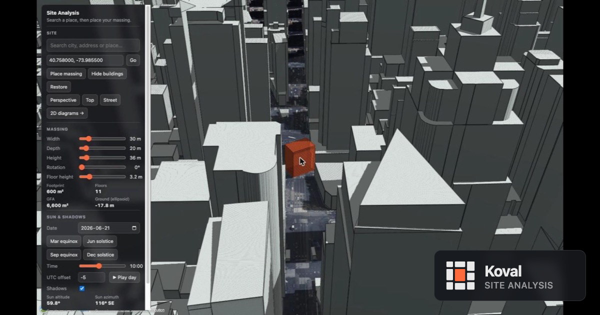
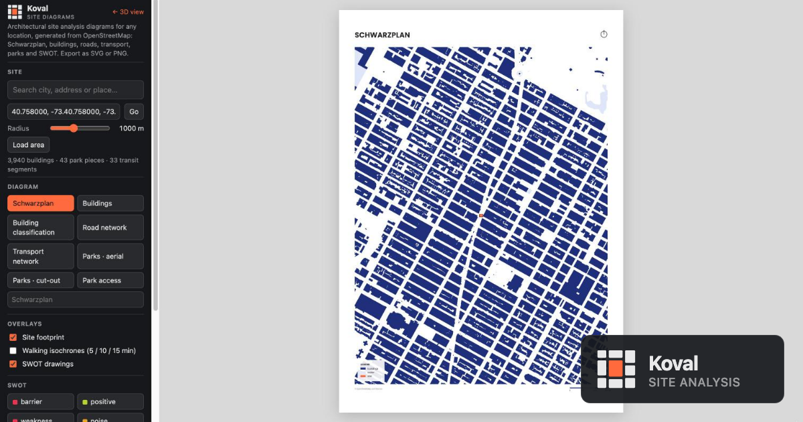

<p align="center">
  <picture>
    <source media="(prefers-color-scheme: dark)" srcset="logo/koval-avatar-dark.svg">
    
  </picture>
</p>

<h1 align="center">Koval</h1>

<p align="center">
  <strong>Free site analysis tools for architects, urban designers and students.</strong><br>
  Koval runs in the browser with no install and no account: search a place, drop a massing on real terrain and buildings, run a sun study, and print Schwarzplan, road, transport and parks diagrams from OpenStreetMap.
</p>

<p align="center">
  <a href="https://siteanalysis.github.io"></a>
  
  
  
  
</p>

<p align="center">
  <a href="https://siteanalysis.github.io"></a>
</p>

## Why Koval?

Early-stage site analysis usually means a day of GIS exports, CAD clean-up and screenshots before you can show anything. Koval is for the first hour instead: open a tab, type an address, and in a couple of minutes you have a massing in context, sun angles for the date you care about, and an A3 diagram sheet you can drop into a presentation.

- 🌍 **Any site on Earth.** World terrain, OpenStreetMap buildings and vector tiles, so it works for your studio project in Oslo as well as your competition entry in São Paulo.
- 🧱 **Real context, not a flat map.** Massing sits on true ground elevation among 3D neighbours, with shadows cast by both.
- 🖨️ **Sheets, not screenshots.** Diagrams come out as A3 SVG or 300 dpi PNG with legend, scale bar and north arrow, ready for InDesign or a plotter.
- 🔓 **Free and open.** No sign-up, no watermark, no server of ours in the loop. Everything runs in your browser against public map services.

## Tools

### 3D massing and sun study (`index.html`)

<p align="center">
  <a href="https://siteanalysis.github.io"></a>
</p>

- **Search** any city, address or place, or paste coordinates
- **Place a massing** with a click, then tune width, depth, height, rotation and floor height with sliders
- **Live metrics:** footprint, floor count, gross floor area and ground elevation
- **Hide and restore** neighbouring buildings to test a cleared site
- **Camera presets:** perspective, top-down and street level
- **Sun and shadows** for any date and time, with one-click equinox and solstice dates and a UTC offset
- **Play the day** to watch shadows sweep across the site
- **Sun readouts:** altitude, azimuth, sunrise and sunset

### 2D diagram sheets (`diagrams.html`)

<p align="center">
  <a href="https://siteanalysis.github.io/diagrams.html"></a>
</p>

Pick a site and a radius from 400 m to 2 km, load the area, and switch between presets. Every preset is drawn from the same layer definition on screen and in the export, so what you see is what you print.

| Preset | What it shows |
| --- | --- |
| **Schwarzplan** | Classic figure-ground: buildings in navy, water in pale blue, everything else white |
| **Buildings** | 2.5D extrusions using building heights from the vector tiles |
| **Building classification** | Thirteen use classes, from residential and education to retail, hospitality and industrial |
| **Road network** | Seven road classes from paths to primary roads, weighted by hierarchy |
| **Transport network** | Train, subway and tram tracks over a faded street grid |
| **Parks · aerial** | Green space over Esri World Imagery |
| **Parks · cut-out** | Green space isolated on a white sheet |
| **Park access** | Parks with 5, 10 and 15 minute walking isochrones from the site |

Overlays go on top of any preset:

- **Site footprint** marker in Koval orange
- **Walking isochrones** at 5, 10 and 15 minutes, computed by Valhalla on the OpenStreetMap routing server
- **SWOT drawings:** barriers, positive areas, weaknesses, noise sources, green connections and opportunity arrows, each with its own line style and legend entry

Export the sheet as **SVG** (editable in Illustrator or Inkscape, with Poppins embedded) or **PNG** at A3 300 dpi.

## How it works

Koval has no backend. Each page is a single HTML file plus a few ES modules, and all the data comes from public services at load time:

| Need | Source |
| --- | --- |
| Terrain and 3D buildings | [Cesium World Terrain](https://cesium.com/platform/cesium-ion/content/cesium-world-terrain/) and [Cesium OSM Buildings](https://cesium.com/platform/cesium-ion/content/cesium-osm-buildings/) via Cesium ion |
| Buildings, roads, parks, water, rail for diagrams | [OpenFreeMap](https://openfreemap.org/) vector tiles, decoded in the browser |
| Aerial imagery | Esri World Imagery |
| Place search | Cesium ion geocoder (3D) and [Photon](https://photon.komoot.io/) by komoot (2D) |
| Walking isochrones | [Valhalla](https://valhalla1.openstreetmap.de/) public instance |
| Sun position | [SunCalc](https://github.com/mourner/suncalc) |

Rendering is [CesiumJS](https://cesium.com/platform/cesiumjs/) for the globe, [MapLibre GL](https://maplibre.org/) for the on-screen diagrams, Canvas for the 2.5D preset and hand-built SVG for export, with [Turf.js](https://turfjs.org/) for geometry, [D3](https://d3js.org/) for projections and [Terra Draw](https://terradraw.io/) for SWOT drawing.

## Run locally

Serve the folder with any static server:

```sh
git clone https://github.com/siteanalysis/siteanalysis.github.io.git
cd siteanalysis.github.io
python3 -m http.server 8000
```

then open http://localhost:8000.

The committed `config.js` holds a Cesium ion token restricted to the live domain, so the 3D page will not load terrain or buildings from localhost. Create a free token at [ion.cesium.com/tokens](https://ion.cesium.com/tokens) and put it in `config.js` (see `config.example.js`). The diagrams page needs no token.

### Project layout

```
.
├── index.html          # 3D massing and sun study (CesiumJS)
├── diagrams.html       # 2D diagram sheets (MapLibre + SVG export)
├── js/
│   ├── diagrams.js     # Diagrams page state, UI and export
│   ├── presets.js      # Layer definitions for every preset, overlay and SWOT category
│   ├── render.js       # Canvas and SVG rendering, legend, scale bar, north arrow
│   └── osm.js          # Vector tile loading, geocoding and isochrones
├── logo/               # Koval mark, lockups and avatars
├── config.js           # Cesium ion token (restricted to the live site)
└── config.example.js   # Template for your own token
```

## Contributing

Issues and pull requests are welcome. New diagram presets are easy to add in `js/presets.js`: a preset is a list of layer specs, and the same spec renders on screen, to canvas and to SVG. If you add a preset, please include an exported sheet in the pull request so it can be checked at print size.

## Author

Built by [Constantine Malynin](https://github.com/ConstantineMalynin).

---

<sub>Map data © <a href="https://www.openstreetmap.org/copyright">OpenStreetMap contributors</a>, served by OpenFreeMap, Cesium ion and the Valhalla public server. Aerial imagery © Esri. Koval is an independent project and is not affiliated with Cesium, Esri, komoot or the OpenStreetMap Foundation.</sub>
